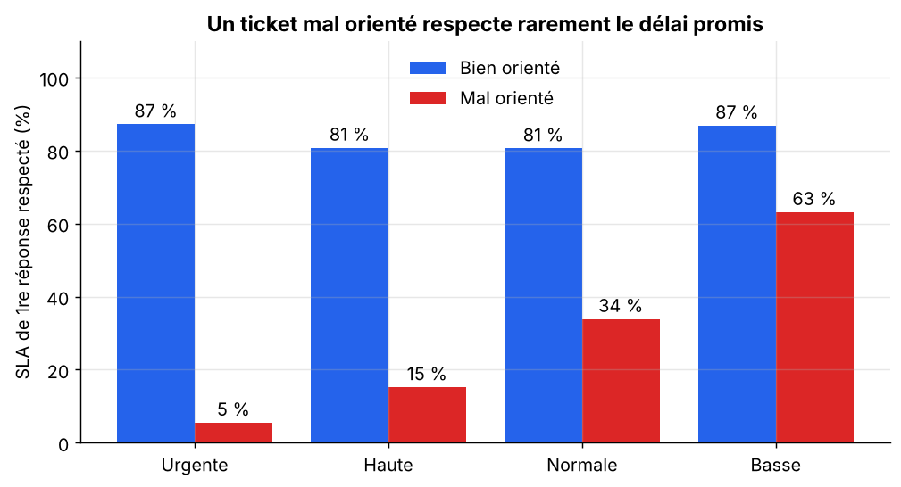
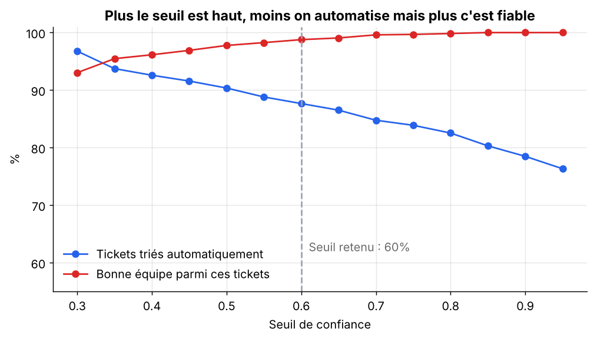
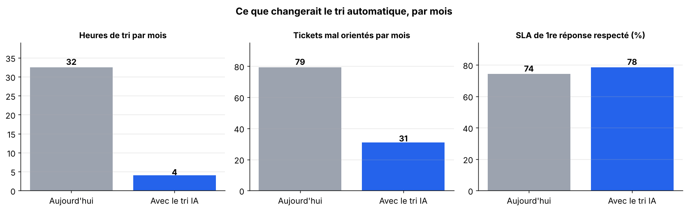

# Tri automatique des tickets du service client par IA

**Analyse des délais d'un service client B2B, tri automatique des tickets par machine learning et mesure des gains.**

Projet personnel · Python, pandas, scikit-learn, matplotlib, Excel · Havar Baskara

---

## En bref

TechDistrib, un distributeur informatique B2B fictif, reçoit environ **500 tickets de support par mois**. Aujourd'hui, un agent lit chaque ticket pour l'envoyer à la bonne équipe (logistique, comptabilité, SAV...).

| | Aujourd'hui | Avec le tri IA |
|---|---|---|
| Temps de tri des tickets | 32 h par mois | **4 h par mois** |
| Tickets envoyés à la mauvaise équipe | 16 % | **6 %** |
| Délai de première réponse respecté (SLA) | 74 % | **78 %** |

Le modèle oriente seul **88 % des tickets avec 98,8 % de bonnes réponses** et laisse les messages ambigus à un agent.

> ⚠️ **Les données sont simulées** par le script `src/generer_donnees.py`. Aucune entreprise ni aucun client réel. Les résultats donnent un ordre de grandeur, pas une mesure réelle.

---

## 1. Le problème

L'analyse des 6 000 tickets d'une année montre qu'**environ 1 ticket sur 6 est envoyé à la mauvaise équipe**. Il doit alors être réorienté, ce qui retarde la réponse de près de 7 heures ouvrées en moyenne.



Un ticket mal orienté ne respecte le délai de réponse promis que dans **32 % des cas**, contre plus de **80 %** pour les autres. Pour un ticket urgent, ce taux tombe à 5 %. Le tri manuel prend aussi près de **4 minutes par ticket**.

## 2. La solution : un tri automatique par IA

Un modèle lit le message du client et propose **l'équipe** qui doit traiter le ticket et **son niveau d'urgence**.

- **Méthode :** TF-IDF (représentation du texte) + régression logistique. Simple, rapide et explicable : on peut montrer aux équipes métier quels mots ont mené à chaque décision.
- **Évaluation réaliste :** apprentissage sur les 9 premiers mois, test sur les 3 derniers, jamais vus par le modèle.
- **Seuil de confiance :** le modèle ne trie seul que les tickets dont il est sûr à plus de 60 %. Les autres restent lus par un agent. L'IA assiste le service client, elle ne le remplace pas.



| Résultat sur la période de test | |
|---|---|
| Bonne équipe trouvée (tous les tickets) | 91 % |
| Tickets triés automatiquement | 88 % |
| Bonne équipe parmi ces tickets | 98,8 % |
| Tickets urgents correctement repérés | 100 % |

## 3. Les gains



Chaque mois, le tri automatique libérerait **près de 30 heures d'agent** et éviterait **environ 50 réorientations**, soit plus de 300 heures d'attente en moins pour les clients. Les hypothèses de calcul sont détaillées dans le notebook 3.

## 4. Un reporting prêt à partager

Le script `src/analyse.py` génère un fichier Excel (`reports/reporting_support.xlsx`) qui peut être relancé chaque semaine : synthèse des indicateurs, détail par équipe, par catégorie et par mois, et liste des tickets hors délai à traiter en priorité.

---

## Contenu du projet

```
support-client-ia/
├── data/
│   └── tickets_support.csv          ← 6 000 tickets simulés
├── notebooks/
│   ├── 01_analyse_des_tickets.ipynb ← indicateurs, délais, effet des erreurs d'orientation
│   ├── 02_tri_automatique_ia.ipynb  ← modèle de tri, évaluation, seuil de confiance
│   └── 03_mesure_des_gains.ipynb    ← temps gagné, erreurs évitées, SLA
├── reports/
│   ├── figures/                     ← graphiques
│   └── reporting_support.xlsx       ← reporting Excel
├── src/
│   ├── generer_donnees.py           ← création des données simulées
│   ├── analyse.py                   ← indicateurs et reporting Excel
│   ├── modele_tri.py                ← entraînement et évaluation du modèle
│   ├── gains.py                     ← estimation des gains
│   └── trier_ticket.py              ← trie un nouveau ticket en une commande
└── requirements.txt
```

## Lancer le projet

```bash
pip install -r requirements.txt

python src/generer_donnees.py   # recrée les données
python src/analyse.py           # indicateurs + reporting Excel
python src/modele_tri.py        # entraîne et évalue le modèle
python src/gains.py             # estime les gains
```

Trier un nouveau ticket :

```bash
python src/trier_ticket.py "Notre commande CMD-12345 n'est toujours pas livrée, nos équipes ne peuvent pas travailler. C'est urgent"
```

```
Équipe    : Logistique (confiance 90%)
Priorité  : Urgente
Décision  : envoi automatique à l'équipe
```

## Les données simulées

Chaque ticket contient : la date, le canal (e-mail, portail, téléphone), le type de client, **le message du client**, la catégorie, la priorité, la bonne équipe, l'équipe choisie lors du tri manuel, le temps de tri, les délais de première réponse et de résolution, et la satisfaction (1 à 5).

Pour se rapprocher de la réalité, environ 15 % des messages évoquent deux sujets à la fois et 9 % sont vagues (« pouvez-vous me rappeler au sujet de ma commande ? »). Ce sont ces messages qui sont le plus souvent mal orientés, par les agents comme par le modèle.

## Limites et prochaines étapes

- **Données simulées :** les messages sont construits à partir de modèles de phrases, plus réguliers que de vrais messages. Sur de vraies données, les performances seraient plus basses.
- **Le modèle ne connaît que les formulations qu'il a vues :** une demande formulée de façon très différente peut être mal comprise. D'où l'importance du seuil de confiance et du suivi des erreurs.
- **Étapes suivantes pour un déploiement :** tester le tri sur une équipe pilote pendant quelques semaines, suivre chaque mois le taux d'erreur dans le reporting, réentraîner le modèle régulièrement et le brancher sur l'outil de ticketing (API, Make ou Zapier).

## Compétences mobilisées

Analyse de données (pandas) · Indicateurs et SLA · Visualisation (matplotlib) · Reporting Excel automatisé · Machine learning sur du texte (scikit-learn) · Évaluation d'un modèle · Mesure de l'impact d'une solution IA
